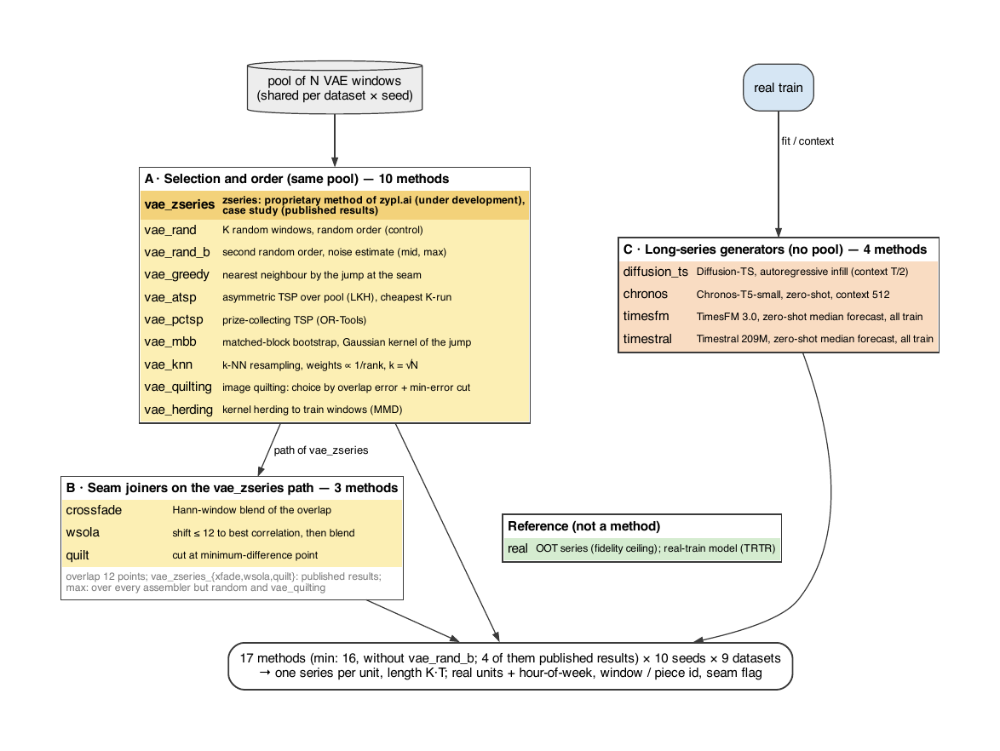

# MarathonTS

[](LICENSE)
[](docs/GETTING_STARTED.md)
[](https://zypl-ai.github.io/MarathonTS/)
[](https://huggingface.co/datasets/zyplai/MarathonTS)
[](https://huggingface.co/spaces/zyplai/MarathonTS)
<!-- With the arXiv identifier (assigned at submission, filled in before the repository is opened): [](https://arxiv.org/abs/XXXX.XXXXX) -->
<!-- After the PyPI release: [](https://pypi.org/project/marathonts/) -->

**A benchmark of long synthetic time series from window assembly and long-series generators.**

Many uses of synthetic time series need a series much longer than the windows a generative model is
trained on. MarathonTS compares the two ways to obtain one under a single protocol: **assembly** from a pool
of short generated windows (which windows, in what order, how the seams are processed) and
**long-series generators** (Diffusion-TS, Chronos, TimesFM, Timestral). Every method yields a series of the
same length; the benchmark measures its fidelity to the real data, its utility for models trained on it,
its memorisation of the training data and its cost. The statistics (rankings, research questions with
tests and uncertainty, a pre-specified confirmatory family) are a separate stage that reads the benchmark
tables.

| Resource | Link |
|---|---|
| Paper | arXiv: to be announced |
| Code | https://github.com/zypl-ai/MarathonTS |
| Package | https://pypi.org/project/marathonts/ (`pip install marathonts`) |
| Data | https://huggingface.co/datasets/zyplai/MarathonTS (full benchmark artifacts) |
| Leaderboard | https://huggingface.co/spaces/zyplai/MarathonTS (interactive view of the published rankings) |
| Documentation | https://zypl-ai.github.io/MarathonTS/ |

<p align="center">
  
</p>

| | |
|---|---|
| Methods in the result tables | 16 in profile `min` (12 run by the pipeline + 4 published results), 17 in `mid`, 35 in `max` |
| Fidelity | 83 metrics in 12 groups F1–F12, each against three real references (train, val, OOT) |
| Utility | 14 tasks; models trained on the synthetic series only and tested on real data (TSTR against TRTR) |
| Data | 9 open hourly datasets, 10 seeds |
| Statistics | overall leaderboard, rankings by slice, research questions RQ0–RQ9, confirmatory family C1–C4 |

## Quick start

A smoke test runs the whole pipeline on 2 datasets (`ett`, `bike`), 2 seeds and small models
(`Config.quick()`); both datasets are downloaded without credentials. Local run in one environment
(Linux or macOS, Python 3.11 or 3.12, `git` on the path):

```bash
git clone https://github.com/zypl-ai/MarathonTS.git
cd MarathonTS
python3 -m venv .venv && source .venv/bin/activate
pip install -r requirements.txt
git clone https://github.com/Y-debug-sys/Diffusion-TS.git external/Diffusion-TS
git -C external/Diffusion-TS checkout 566307e6cf2d8095e58de4c6e3a6ae965b69b5b5

python -m marathonts.bench.run all --quick                            # data → pools → series → fidelity → utility → tables
python -m marathonts.hypotheses.run --artifacts-dir artifacts/quick   # reports → artifacts/quick/reports/
```

The benchmark is also installable as a package, `pip install marathonts` (the same commands; see
[Guide C, C0](docs/GETTING_STARTED.md#c0-install-the-package-from-pypi)). The pretrained generators (Chronos,
TimesFM, Timestral) download their weights from Hugging Face on first use. The same test with Docker: [Guide A, A2](docs/GETTING_STARTED.md#a2-smoke-test); in Colab:
[Guide B, B4](docs/GETTING_STARTED.md#b4-smoke-test).

## Ways to run

| Way | When to use | Guide |
|---|---|---|
| Docker | a Linux machine with Docker (NVIDIA GPU optional); two images (`tsgm` with TensorFlow, `bench` with PyTorch) share `data/` and `artifacts/` | [Guide A](docs/GETTING_STARTED.md#guide-a-docker) |
| Colab notebooks | Google Colab with the project on Google Drive; one notebook per stage, each on its own runtime | [Guide B](docs/GETTING_STARTED.md#guide-b-google-colab) |
| Local environments | your own machine; one virtual environment per dependency set (`envs/*.txt`) or one environment for everything (`requirements.txt`) | [Guide C](docs/GETTING_STARTED.md#guide-c-local-environments) |

Each guide covers the smoke test, the full run of profile `min` and re-running only the analysis on existing
tables.

## Results and how to read them

Stage 7 (`python -m marathonts.hypotheses.run`) writes four Markdown reports to `artifacts/<profile>/reports/`:

| Report | Contents |
|---|---|
| `OVERALL.md` | the overall leaderboard: fidelity on the core metrics and utility with equal weights, noise-aware ranks, robustness checks |
| `LEADERBOARD.md` | the ranking of every method in every slice: the four rankings, core-metric rankings, privacy, cost |
| `METRIC_VALUES.md` | values of the core fidelity metrics and the primary utility metrics by reference, dataset, task, model and split |
| `REPORT.md` | research questions RQ0–RQ9, the confirmatory family C1–C4, the case study CS1–CS15 |

Their Parquet tables are in `artifacts/<profile>/overall/`, `leaderboard/`, `metric_values/` and
`hypotheses/`; the benchmark tables they are computed from are in `artifacts/<profile>/tables/`.
`artifacts/run_h200/` holds the tables and reports of the main run and `artifacts/run_l4/` those of the replication
run; your own runs are written to `artifacts/<profile>/`. The full artifacts of both runs (pools, series, fidelity and utility records,
labels) are on [Hugging Face](https://huggingface.co/datasets/zyplai/MarathonTS), and the rankings of both runs
can be explored in the [interactive leaderboard](https://huggingface.co/spaces/zyplai/MarathonTS), which opens
on the main run. The metrics are defined in
[METRICS.md](docs/METRICS.md), the statistical procedure and the reading of the verdicts in
[HYPOTHESES.md](docs/HYPOTHESES.md).

### Published runs and the main leaderboard

Two runs of profile `min` are published: the **main run** on one NVIDIA H200 (computing infrastructure of
[darya.ai](https://www.greendarya.ai/); 34 methods, 24 ranked: the VAE
and zEDGE pools, the open long-series generators and zEDGE_TS) and a **replication run** on one NVIDIA L4 (the
VAE pool and the open long-series generators, 13 ranked). Every result of the paper and the leaderboard below
come from the main run; the replication run shows how the results reproduce on another hardware and software stack. Ranks and
times are compared only within a run. Their setup, the comparison and the sources of the differences
(retrained generators, sampling, downstream models, a slightly different ETT series in the main run) are in
[BENCHMARK.md](docs/BENCHMARK.md#published-runs).

Overall leaderboard of the main run, in full (24 ranked methods; \* proprietary, evaluated as a black box).
Read it by tier, not by place: the tests do not separate the places within the top tier, and these places
change between runs on different hardware ([HYPOTHESES.md](docs/HYPOTHESES.md)).

| place | method | family | mean rank | 95 % interval | P(first) | top tier | datasets |
|---|---|---|---|---|---|---|---|
| 1 | `zedge_quilting` \* | assembly | 8.27 | 7.35–9.20 | 0.85 | yes | 9 |
| 2 | `zedge_zseries` \* | assembly | 8.79 | 8.28–9.47 | 0.08 | yes | 9 |
| 3 | `zedge_greedy` \* | assembly | 8.95 | 7.97–10.00 | 0.01 | yes | 9 |
| 4 | `zedge_pctsp` \* | assembly | 9.18 | 8.13–10.25 | 0.00 | yes | 9 |
| 5 | `zedge_knn` \* | assembly | 9.33 | 8.32–10.48 | 0.00 | yes | 9 |
| 6 | `zedge_atsp` \* | assembly | 9.39 | 7.83–11.10 | 0.03 | yes | 9 |
| 7 | `zedge_ts_ar` \* | long-series | 9.40 | 7.99–10.91 | 0.02 | yes | 9 |
| 8 | `zedge_ts_long` \* | long-series | 9.50 | 8.25–10.89 | 0.00 | yes | 9 |
| 9 | `zedge_herding` \* | assembly | 10.48 | 9.15–11.88 | 0.00 | yes | 9 |
| 10 | `zedge_mbb` \* | assembly | 10.58 | 9.10–12.25 | 0.00 | yes | 9 |
| 11 | `zedge_rand` \* | assembly (random) | 10.75 | 9.12–12.49 | 0.00 | yes | 9 |
| 12 | `vae_herding` | assembly | 13.53 | 12.79–14.30 | 0.00 | no | 9 |
| 13 | `vae_zseries` \* | assembly | 13.68 | 12.15–15.24 | 0.00 | yes | 9 |
| 14 | `diffusion_ts` | long-series | 13.78 | 11.98–15.39 | 0.00 | no | 9 |
| 15 | `timesfm` | long-series | 14.43 | 12.56–16.23 | 0.00 | yes | 6 |
| 16 | `vae_quilting` | assembly | 14.44 | 12.64–16.20 | 0.00 | yes | 9 |
| 17 | `vae_pctsp` | assembly | 15.27 | 13.80–16.67 | 0.00 | no | 9 |
| 18 | `vae_atsp` | assembly | 15.28 | 13.26–17.10 | 0.00 | no | 9 |
| 19 | `vae_greedy` | assembly | 15.57 | 13.90–17.19 | 0.00 | no | 9 |
| 20 | `chronos` | long-series | 15.78 | 14.04–17.45 | 0.00 | yes | 7 |
| 21 | `vae_knn` | assembly | 16.01 | 14.16–17.70 | 0.00 | no | 9 |
| 22 | `vae_mbb` | assembly | 16.30 | 14.24–18.20 | 0.00 | no | 9 |
| 23 | `vae_rand` | assembly (random) | 16.47 | 14.43–18.39 | 0.00 | no | 9 |
| 24 | `timestral` | long-series | 16.77 | 15.53–18.08 | 0.00 | no | 9 |

## Change the configuration

Every setting is a field of `Config` (`marathonts/bench/config.py`); three profiles (`min`, `mid`, `max`) are
ready-made sets of values. Settings are changed by command-line flags, in the `cfg` cell of the notebooks, in
Python, or by a JSON file — [CONFIGURATION.md](docs/CONFIGURATION.md), which also lists every field with its
default and which stages a change recomputes.

## Add your own component

Datasets, tasks, pool generators, long-series generators, assemblers, seam processing, ML models, fidelity
and utility metrics, statistical tests and hypotheses are registered by name in a plugin file and switched on
by one line of configuration — [EXTENDING.md](docs/EXTENDING.md).

## Documentation

| File | Contents |
|---|---|
| [docs/GETTING_STARTED.md](docs/GETTING_STARTED.md) | requirements, the three ways to run step by step, resuming, troubleshooting |
| [docs/CONFIGURATION.md](docs/CONFIGURATION.md) | `Config`, profiles, every setting, CLI flags, what a change recomputes |
| [docs/EXTENDING.md](docs/EXTENDING.md) | plugins: your own dataset, task, generator, assembler, seam processing, model, metric, test, hypothesis |
| [docs/BENCHMARK.md](docs/BENCHMARK.md) | pipeline, protocol, environments, stages, artifacts, compute volume |
| [docs/HYPOTHESES.md](docs/HYPOTHESES.md) | research questions RQ0–RQ9, ranking, case study CS1–CS15, tests, analysis pipeline |
| [docs/METRICS.md](docs/METRICS.md) | fidelity metrics F1–F12 and utility metrics |
| [docs/MODELS.md](docs/MODELS.md) | the utility ML models and their libraries |
| [docs/BASELINES.md](docs/BASELINES.md) | the compared methods and the alternatives from the literature |
| [docs/DATASETS.md](docs/DATASETS.md) | the nine datasets, preprocessing, leakage into pretrained models |
| [docs/DATASET_LICENSES.md](docs/DATASET_LICENSES.md) | dataset licences and what is published for each dataset |
| [docs/LITERATURE.md](docs/LITERATURE.md) | references |
| [docs/figures/README.md](docs/figures/README.md) | vector figures of the benchmark design |

The same documentation, with an API reference built from the docstrings (`docs/api/`), is a site
(`mkdocs.yml`, published from the repository by `.github/workflows/docs.yml`); locally:

```bash
pip install -r docs/requirements.txt
mkdocs serve                        # http://127.0.0.1:8000
```

## Project structure

```
MarathonTS/
├── marathonts/               # the Python package (pip install marathonts)
│   ├── bench/                #   benchmark: data, generators, assemblers, models, metrics → artifacts/<profile>/
│   │   ├── config.py         #     Config: every setting; the profiles min / mid / max
│   │   ├── run.py            #     the stages: python -m marathonts.bench.run <stage>
│   │   ├── registry.py       #     registries of the pluggable components
│   │   ├── model_configs.json  #   hyperparameters and search grids of the ML models
│   │   └── target_params*.json #   exogenous task thresholds per dataset
│   └── hypotheses/           #   leaderboard, rankings, metric values, research questions → artifacts/<profile>/reports/
├── pyproject.toml            # package metadata and dependencies
├── colab/                    # Colab notebooks 01–07 (one per stage) + colab_setup.py
├── envs/                     # dependencies per environment: base, core, tsgm, diffusion_ts, chronos, timesfm, timestral, sdv;
│                             #   lock/: exact versions of the main run
├── docs/                     # documentation; design figures in docs/figures/ (source: docs/figures/src/);
│                             #   API reference pages docs/api/, site build docs/requirements.txt
├── artifacts/run_h200/       # main run (NVIDIA H200): tables and reports
├── artifacts/run_l4/         # replication run (NVIDIA L4): tables and reports
├── Dockerfile                # two images: tsgm (TensorFlow) and bench (PyTorch, CUDA or CPU)
├── docker-compose.yml        # the stages in the two images with shared data/ and artifacts/
├── mkdocs.yml                # the documentation site
├── requirements.txt          # every environment in one (Python ≤ 3.12)
├── CITATION.cff, CHANGELOG.md, CONTRIBUTING.md
└── LICENSE, NOTICE           # Apache 2.0 for the code
```

Data (`data/`) and the Diffusion-TS code (`external/`) are not in the repository: the data are downloaded by
the `raw` stage, Diffusion-TS is cloned at install time.

## Proprietary methods

Three components are proprietary methods of [zypl.ai](https://zypl.ai/) under development: the assembler zseries
(`vae_zseries` and its seam-processing variants) and, in the main run of the paper, two generators of the
zEDGE family:

- **zEDGE** — a pool generator: it generates the window pool that the assemblers turn into a long series
  (pool prefix `zedge`, methods `zedge_zseries`, `zedge_greedy`, …);
- **zEDGE_TS** — a long-series generator: it generates the long series directly, without a pool. One
  sequence model over the latent vectors of zEDGE is trained per dataset and shared by the seeds; it is
  sampled in two modes:
  - `zedge_ts_long` — block inpainting: the latent sequence is built in blocks of 12 latent vectors, each
    next block conditioned on the last three latent vectors of the previous one;
  - `zedge_ts_ar` — autoregressive: one latent vector at a time, conditioned on the preceding 11; slower,
    but every step agrees with a longer context.

  In both modes every latent vector is decoded into a window, and neighbouring windows (overlap T/2) are
  joined by a cosine crossfade.

They are evaluated as black boxes under the same protocol as every other method: their results
are published in the tables (`Config.frozen_methods`) and enter the rankings and the analysis, their code
is not part of the repository, and their results cannot be reproduced from it. No open method uses any of
their components. Every ranking can be recomputed with any set of methods excluded (`--rank-exclude`).
The paper states the competing interests of the authors.

## Citation

If you use MarathonTS, please cite the paper (the arXiv identifier is filled in at submission, before the release)
and the original source of every dataset you use ([DATASETS.md](docs/DATASETS.md)):

```bibtex
@misc{varshavskiy2026marathonts,
  title         = {{MarathonTS}: A Benchmark of Long Synthetic Time Series from Window Assembly and
                   Long-Series Generators},
  author        = {Varshavskiy, Ilyas and Shulgin, Sergey and Khalilbekov, Shuhrat and Boboeva, Bonu and
                   Azimi, Azizjon},
  year          = {2026},
  eprint        = {XXXX.XXXXX},
  archivePrefix = {arXiv}
}
```

Machine-readable citation metadata: [CITATION.cff](CITATION.cff).

## Authors

Ilyas Varshavskiy ([ORCID 0000-0003-4924-2097](https://orcid.org/0000-0003-4924-2097)),
Sergey Shulgin, Shuhrat Khalilbekov, Bonu Boboeva, Azizjon Azimi — zypl.ai.
Contact: Ilyas Varshavskiy, [ilyas.varshavskiy@zypl.ai](mailto:ilyas.varshavskiy@zypl.ai). Questions and
bug reports: [GitHub issues](https://github.com/zypl-ai/MarathonTS/issues); contributions:
[CONTRIBUTING.md](CONTRIBUTING.md); changes between versions: [CHANGELOG.md](CHANGELOG.md).

## Licence

The code (`marathonts/`, `colab/`, `docs/figures/src/`) is licensed under the
[Apache License 2.0](LICENSE), copyright 2026 zypl Holding Ltd ([NOTICE](NOTICE)).

Datasets and benchmark artifacts (synthetic series, pools, model weights, labels) are not covered by
it: each dataset keeps its own licence, and what is published for each one is listed in
[DATASET_LICENSES.md](docs/DATASET_LICENSES.md).

Third-party components keep their own licences. Diffusion-TS is cloned at install time and is not
part of this repository. The `vae_atsp` assembler uses `elkai`, which bundles the LKH solver: LKH is
free for academic and non-commercial use only, so commercial use of `vae_atsp` requires a licence
for LKH. The weights of TimesFM 3.0 are under the TimesFM Non-Commercial License v1.0, those of
Timestral under a Modified MIT licence; both are downloaded from Hugging Face, not distributed here. The optional pool
generator `sdv_par` uses SDV, licensed under the Business Source License 1.1: it may not be used for a
Synthetic Data Service (as defined by that licence); each SDV version converts to the MIT licence four
years after its release.
